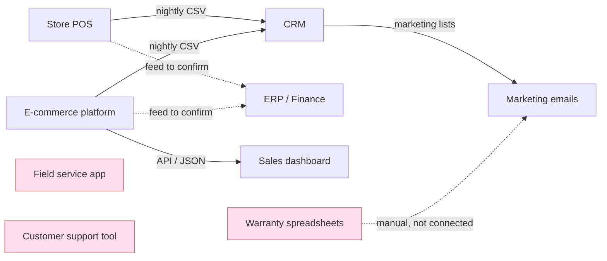

# 03 — Source System Inventory and Current State

> Educational portfolio piece. Brightwell Home & Appliance is fictional. Details marked "to confirm" are assumptions that discovery would verify.
> **Label:** Demonstrated using synthetic data (fictional client scenario).
> **Status:** v1 complete. One ✏️ remains (name the owner of each system after discovery).

## 1. Source system inventory

| # | System | Owner (✏️ to confirm) | What it holds | Data type | How we'd get data out | Customer ID used | Main risk |
|---|---|---|---|---|---|---|---|
| 1 | Store point-of-sale (POS) | Retail operations | In-store sales, receipts | Structured | Database read or export | Phone number (often blank) | Anonymous sales cannot be linked to a customer |
| 2 | E-commerce platform | E-commerce team | Online orders, accounts, payments | Semi-structured (JSON) | API | Email | Same person may use several emails |
| 3 | CRM | Marketing | Marketing contacts, campaigns, loyalty members | Structured | Nightly CSV or database read | Probably email or own ID (to confirm) | Nightly batches mean data is up to a day old |
| 4 | ERP | Finance | Invoices, stock, suppliers, official revenue | Structured | Database read or export | Own account number (to confirm) | Revenue definitions differ from the sales dashboard |
| 5 | Field service app (from FixRight) | Service | Repair and installation jobs, engineer visits, parts | Structured | Export or API (to confirm) | Own customer list | Addresses typed by engineers vary in spelling |
| 6 | Customer support tool | Support | Calls, emails, complaints, tickets | Structured plus free text | Export or API (to confirm) | Name (agents search by name) | Name searches create wrong matches |
| 7 | Warranty spreadsheets | One team (✏️ named person) | Warranty plans sold and claims | Structured but manual (Excel) | File pickup | Customer name and/or email (Vector's assessment, to confirm); can be looked up in the CRM by the same fields | Manual typing errors affect warranty status and revenue (Vector's risk) |

## 2. Current-state architecture (as understood from interviews)

Solid lines are flows stated in the scenario. Dotted lines are assumed or manual. The three pink boxes have no automated link to the others.

## 3. What this picture tells us

- Seven systems, at least five different ways of identifying a customer (phone, email, name, own IDs).
- Three systems (field service, support, warranty spreadsheets) are isolated, which explains why engineers and agents lack the customer's history.
- Sales dashboard and ERP are fed separately, which is a likely cause of the revenue mismatch (to test, see 01-business-problem-and-discovery.md).

## 4. Open questions for discovery

- How does each sale reach the ERP, and how often?
- Where do wholesale or partner-store sales live? (asked in discovery)
- Who owns each system and who approves access to its data?
