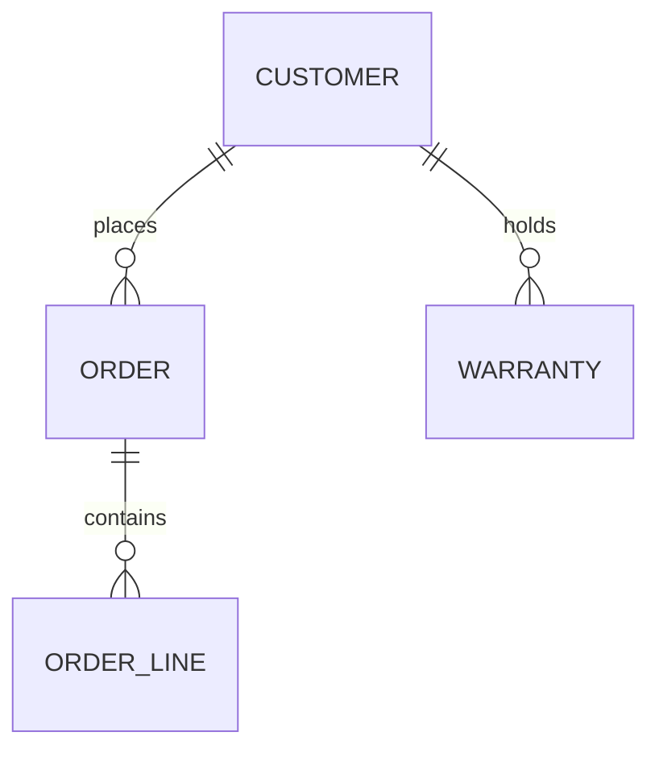

# 04 — Data Model and Synthetic Data

> Educational portfolio piece. Brightwell Home & Appliance is fictional and all data in `sample-data/` is synthetic, with deliberate errors.

**Label:** Demonstrated using synthetic data (fictional client scenario).

## 1. Core concepts used

- **Primary key (PK):** a unique ID for each row.
- **Foreign key (FK):** a field that points to a row in another table.
- **One to many:** one customer has many orders, warranties, visits and tickets.

## 2. Target data model (simplified)

- **CUSTOMER:** customer_id (PK), full_name, email, phone, address_line, postcode, last_activity_date
- **ORDER:** order_id (PK), customer_id (FK), order_date, invoice_number, total_amount
- **ORDER_LINE:** order_line_id (PK), order_id (FK), product_id, quantity, unit_price
- **WARRANTY:** warranty_id (PK), customer_id (FK), product_id, start_date, end_date, status

Design rule: facts that can repeat for one customer (orders, warranties) live in their own tables, never inside CUSTOMER.

## 3. Synthetic data and planted problems

Files in `sample-data/`: `crm_contacts.csv`, `pos_sales.csv`, `warranty_sheet.csv`.

- **C003 and C004:** same person (same email, phone, postcode), spelled "James O'Neil" and "Jim ONeil". Duplicate.
- **C005 and C008:** same person, "Aisha Khan" and "A. Khan". Duplicate.
- **C001 and C002:** same name but different email and postcode. Probably two different people. Matching on name alone would wrongly merge them.
- **C006:** missing phone number, so it cannot be matched to a store sale.
- **W02:** end date is in the past but status is "Active".
- **W03:** end date is before the start date, and the email is missing.
- **W05:** "Maria Lopes" in the spreadsheet vs "Maria Lopez" in the CRM.
- **R1003 (POS):** no customer phone, so the sale cannot be linked to a customer.
- **R1004 and R1005 (POS):** same product and amount on consecutive days at the same store, a possible duplicate sale.
- **R1006 (POS):** negative amount, a refund that is not clearly labelled.

## 4. What happens next

These problems become the data quality and matching rules in milestone 1.7.
