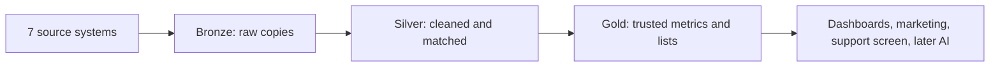

# 06 — Target Architecture

> Educational portfolio piece. Brightwell Home & Appliance is fictional. Platform choice is deferred to 10-technology-options.

**Label:** Proposed future implementation (design only).

## 1. Storage approach

A **lakehouse**: one platform combining low-cost storage for raw files (like a data lake) with governed, structured tables for reporting (like a data warehouse). Reason: Brightwell has both structured tables (ERP, POS) and semi-structured data (e-commerce JSON), and needs trusted reports.

## 2. Layers

- **Bronze (raw):** an untouched, timestamped copy of every source extract, errors included. Purpose: audit evidence and the ability to rebuild. Not used for reporting.
- **Silver (cleaned and matched):** formats standardised, errors flagged or corrected, duplicate customers matched into one customer ID. Purpose: records that are correct and consistent. Example: C003 and C004 become one customer.
- **Gold (business-ready):** agreed metrics and ready-to-use tables. Purpose: answer business questions. Examples: one "active customer" count, revenue that reconciles with Finance, the list of customers who must not receive a warranty email.

Rule of thumb: Silver answers "is this record correct?", Gold answers "what does the business want to know?". Reports and marketing use Gold only.

## 3. Why three layers (plain-language explanation for a client)

Keeping the original data untouched means we can always prove what we received and rebuild everything if a rule or business need changes, without asking the source systems again. Cleaning happens in one place, so every team gets the same trusted answer.

## 4. Task placement

- Store the warranty spreadsheet exactly as received: Bronze.
- Merge duplicate customers (C003 and C004): Silver.
- Fix or flag impossible dates (W03): Silver (Bronze keeps the original).
- Calculate the agreed "active customer" count: Gold.
- Produce the "do not email" warranty list: Gold.

## 5. Data flow summary

1. Sources are ingested on the schedules in 05-ingestion-design.md.
2. Raw copies land in Bronze.
3. Quality rules and matching (07) produce Silver.
4. Metric definitions (09) produce Gold.
5. Access to each layer is controlled (08): most users see Gold only.

## 6. Risks

- Layers add storage and effort; keep Bronze retention rules explicit (08).
- Poor matching rules in Silver spread errors to Gold; matching is tested with the sample data (07).
